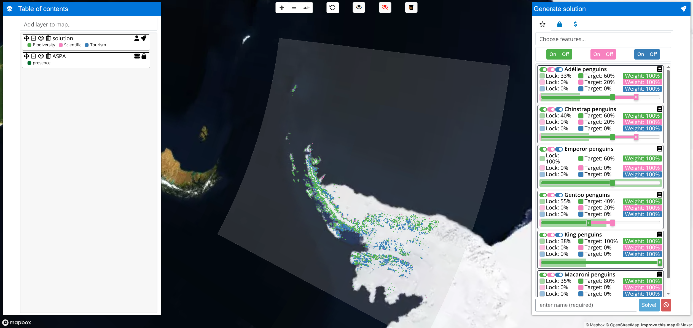
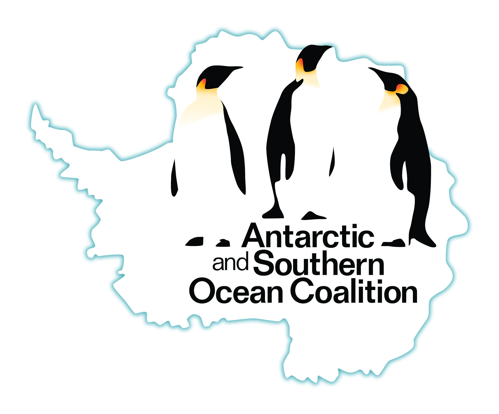

<!--- README.md is generated from README.Rmd. Please edit that file -->

# apscp: Decision Support Tool for the Antarctic Peninsula

[](https://lifecycle.r-lib.org/articles/stages.html)
[](https://github.com/asoc-org/apscp/actions)
[](https://github.com/asoc-org/apscp/actions)
[](https://github.com/asoc-org/apscp/actions)
[](https://codecov.io/github/asoc-org/apscp?branch=main)

Interactive decision support tool to navigate management options for the
Antarctic Peninsula. The tool identifies priority areas for implementing
policies for conservation, tourism, and scientific research. To achieve
this, it leverages previously published data ([Lee et
al. 2024](https://doi.org/10.1007/s13280-024-02009-4)) and
multi-objective optimization techniques through the [*prioritizr*
package](https://prioritizr.net) ([Hanson et
al. 2025](https://doi.org/10.1111/cobi.14376)). Although default
parameters are specified based on stakeholder surveys, users can
calibrate weights and representation targets to fine tune optimization
procedures according to their own preferences. Optimization procedures
can be performed with the [*Gurobi*](https://www.gurobi.com/) or
[*CBC*](https://github.com/coin-or/cbc) (via the
[*rcbc*](https://github.com/dirkschumacher/rcbc) package) exact
algorithm solvers.

## Usage

The application is available online. Please note that you must use
[*Google Chrome*](https://www.google.com/chrome/) for it to work.

<table style="border:none;border-spacing:0;">

<tr style="border:none;border-spacing:0;">

<td style="border:none;border-spacing:0;">


</td>

</tr>

</table>

## Installation

The application is available as an online service provided by the
[Antarctic and Southern Ocean Coalition](https://www.asoc.org/). If you
need to run the application directly on your own computer, then you can
run it using the [*R* statistical computing
environment](https://www.r-project.org/),
[*Docker*](https://www.docker.com/), or [*Docker
Compose*](https://docs.docker.com/compose/). **Note that if you choose
to run the application directly on your computer, you will need to have
obtained a [*Mapbox*
token](https://docs.mapbox.com/help/getting-started/access-tokens/) and
configured your computer so that the application can find the token.**

### Obtaining and setting up a Mapbox token

To begin with, you will need to obtain a *Mapbox* token. This is because
the application uses *Mapbox* for displaying maps. To obtain a token,
please refer to [*Mapbox* documentation for detailed
instructions](https://docs.mapbox.com/help/getting-started/access-tokens/).
After obtaining a token, you will then need to save the token on your
computer.

- If you intend to run the application using *R*, you can save the token
  in your `.Renviron` file. You can use the *R* code
  `usethis::edit_r_environ()` to automatically find and open this file.
  After finding and opening this file, you can save the token by adding
  the following text to it (replacing `**INSERT_TOKEN_HERE**` with the
  actual token value).

      MAPBOX_PUBLIC_TOKEN=**INSERT_TOKEN_HERE**

- Alternatively, if you intend to run the application using *Docker* or
  *Docker Compose*, you can save the token as a system environmental
  variable named `MAPBOX_PUBLIC_TOKEN`. To complete this step on a
  Windows computer, please [refer to these
  instructions](https://www.autodesk.com/support/technical/article/caas/sfdcarticles/sfdcarticles/How-to-set-an-environment-variable.html).
  On a Linux or macOS system, this step can be completed by opening the
  `~/.bashrc` file or `~/.zshrc` file (which ever file already exists)
  and then adding the following text to it (replacing
  `**INSERT_TOKEN_HERE**` with the actual token value).

      export MAPBOX_PUBLIC_TOKEN=**INSERT_TOKEN_HERE**

### Using R

To use this method, you will need to install the [*R* statistical
computing environment](https://www.r-project.org/). After completing the
installation, you can install the application using the following *R*
code:

``` r
if (!require(remotes)) install.packages("remotes")
remotes::install_github("asoc-org/asoc")
```

You can then use the following R code to start the application and open
it in your web browser:

``` r
asoc::run_app()
```

### Using Docker

To use this method, you will need to install [*Docker
Engine*](https://www.docker.com/) ([see here for
instructions](https://docs.docker.com/get-docker/)). After completing
this step, you can install the application from the [container
repository](https://github.com/asoc-org/apscp/pkgs/container/apscp).
Specifically, please use the following system command for the latest
stable release.

``` bash
# run latest stable release
docker run -e MAPBOX_PUBLIC_TOKEN -dp 3838:3838 --name apscp -it ghcr.io/asoc-org/apscp:latest
```

Alternatively, you can instead use the following system command for the
most recent developmental release.

``` bash
# run developmental release
docker run -e MAPBOX_PUBLIC_TOKEN -dp 3838:3838 --name apscp -it ghcr.io/asoc-org/apscp:dev
```

After running the system command, you can view the application by
opening the following link in [*Google
Chrome*](https://www.google.com/chrome/): `http://localhost:3838`. After
you have finished using the application, you can terminate it using the
following system command. **Note that if you don’t terminate the
application once you are finished using it, then it will continue
running in the background.**

``` bash
docker rm -f apscp
```

### Using Docker Compose

To use this method, you will need to install [*Docker
Engine*](https://www.docker.com/) ([see here for
instructions](https://docs.docker.com/get-docker/)) and *Docker Compose*
([see here for instructions](https://docs.docker.com/compose/install/)).
After installing both programs, you can install the application by
[cloning this
repository](https://docs.github.com/en/github/creating-cloning-and-archiving-repositories/cloning-a-repository-from-github/cloning-a-repository)
and then using the following system commands:

``` bash
docker-compose pull
docker-compose up -d
```

You can then view the application by opening the following link in
[*Google Chrome*](https://www.google.com/chrome/):
`http://localhost:3838`. After you have finished using the application,
you can terminate it using the following system command. **Note that if
you don’t terminate the application once you are finished using it, then
it will continue running in the background.**

``` bash
docker-compose down
```

## Getting help

Thank you for checking out this application. If you encounter any
software defects (e.g. application crashes, unexpected behavior, or
spelling mistakes), please feel free to post them on the [issue
tracker](https://github.com/asoc-org/apscp/issues).

## Acknowledgments

This project is supported and led by the [Antarctic and Southern Ocean
Coalition (ASOC)](https://www.asoc.org/). The
[data](https://doi.org/10.26180/29092346) and foundations underlying the
project were produced during the [SCAR-IAATO Systematic Conservation
Planning Project](https://scar.org/scar-news/scar-iaato-scp), which was
supported by the [International Association of Antarctica Tour Operators
(IAATO)](https://iaato.org/), the [Scientific Committee on Antarctic
Research (SCAR) and Monash University](https://scar.org/). This work was
supported by [Gurobi Optimization](https://www.gurobi.com/) through
their [Gurobi Gives Back
program](https://www.gurobi.com/company/gurobi-gives-back), which
provides free access to optimization software for qualifying
non-profits.

<table style="border:none;border-spacing:0;">

<tr style="border:none;border-spacing:0;">

<td style="border:none;border-spacing:0;vertical-align:middle;">


</td>

<td style="border:none;border-spacing:0;vertical-align:middle;">


</td>

</tr>

</table>
